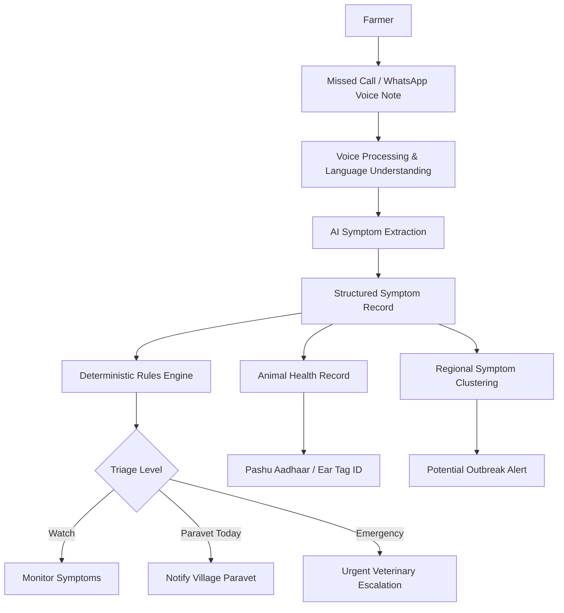

# 🐄 JeevSanket – AI Livestock Health & Outbreak Early-Warning Agent

**Faster help for every sick animal. Earlier warning for every village.**

**Team:** Aadya | Diya | Kavya  
**Competition:** Tech4Bharat 2026  
**Problem Statement:** 6.2 – AI Livestock Health & Outbreak Early Warning

---

## 🌱 Overview

**JeevSanket** is a voice-first, AI-powered livestock health and outbreak early-warning platform designed to make veterinary assistance more accessible to dairy farmers across rural India.

Farmers can report animal health concerns through a toll-free missed call or WhatsApp voice note in their preferred local language. An AI-powered language processing layer converts these voice reports into structured symptom records, while a deterministic, rule-based engine evaluates the reported symptoms and assigns a safety category.

The platform connects farmers with nearby village paravets, identifies emerging disease patterns through regional symptom clustering, and maintains animal-specific health records linked to Pashu Aadhaar ear-tag IDs.

JeevSanket aims to move livestock healthcare from **reactive treatment to proactive prevention**, reducing avoidable animal health losses while strengthening rural veterinary networks.

## 🚨 The Problem

Livestock farmers face several challenges when accessing timely veterinary care:

- **Delayed medical assistance:** Farmers may struggle to identify the seriousness of symptoms or reach a veterinary professional quickly.
- **Limited veterinary access:** Rural and remote communities often face gaps in veterinary availability.
- **Undetected disease outbreaks:** Individual cases may go unnoticed as part of a larger regional disease pattern.
- **Economic losses:** Diseases such as mastitis and haemorrhagic septicaemia can significantly affect milk production and livestock value.
- **Poor health documentation:** Inconsistent animal health records can complicate insurance claims and treatment tracking.

These challenges affect not only individual farmers but also dairy cooperatives and the wider livestock economy.

## 💡 Our Solution

JeevSanket provides an integrated livestock health support system through five major components:

### 1. 🎙️ Voice-First Symptom Reporting
- Farmers connect through a toll-free missed call or WhatsApp voice note.
- Supports reporting in local languages.
- AI processes voice input and extracts structured symptoms.
- Converts unstructured descriptions into standardized health records.

### 2. 🧠 Deterministic Health Triage
A fixed, rule-based engine evaluates extracted symptoms and assigns one of three urgency levels:

| Level | Meaning | Recommended Action |
|---|---|---|
| 🟢 Watch | No immediate warning signs identified | Monitor symptoms |
| 🟠 Call a Paravet Today | Requires timely professional assessment | Contact a village paravet |
| 🔴 Emergency | Potentially serious warning signs | Urgent veterinary escalation |

**Safety principle:** AI extracts and structures information; the deterministic rules engine controls triage decisions. The system does not claim to provide a veterinary diagnosis.

### 3. 🏥 Paravet Escalation Network
- Urgent cases are routed to the appropriate village paravet.
- Farmers receive guidance on the next steps.
- Paravets can access structured case information before visiting.
- Creates opportunities for faster intervention and better follow-up.

### 4. 📍 Community-Level Outbreak Detection
- Aggregates symptom reports across villages and regions.
- Identifies unusual increases in similar symptom patterns.
- Generates early-warning alerts for potential disease clusters.
- Helps veterinary authorities and milk unions prioritize field investigations.

### 5. 🐮 Digital Livestock Health Records
- Links health records to Pashu Aadhaar / animal ear-tag IDs.
- Maintains animal-specific medical histories.
- Supports treatment tracking and documentation.
- Helps organize insurance-related records and claim documentation.

---

## ⚙️ How It Works

## 🏗️ Core System Architecture

JeevSanket follows a modular architecture:

| Layer | Responsibility |
|---|---|
| Farmer Interface | Missed-call and WhatsApp voice-based interaction |
| Voice Processing | Speech-to-text and local-language processing |
| AI Extraction | Converts farmer descriptions into structured symptoms |
| Safety Engine | Applies deterministic triage rules |
| Escalation Layer | Routes cases to village paravets |
| Outbreak Intelligence | Detects regional symptom clusters |
| Livestock Records | Stores animal-specific health and insurance information |

## 💰 Business Model & Sustainability

JeevSanket follows a **B2B2C model**, with district milk unions acting as the primary paying customers while farmers receive accessible health support.

**Proposed revenue model:**
- Annual subscription fee collected through district milk unions.
- Small per-animal annual fee, potentially deducted from milk payments.
- Reduced dependence on direct farmer payments.
- Improved value for cooperatives through better livestock health monitoring and documentation.

### Preliminary Economic Estimates

| Metric | Estimated Value |
|---|---:|
| Annual avoided loss per animal | ₹200 |
| Proposed annual union fee per animal | ₹60 |
| Estimated pilot ROI | 3.3× |
| Potential annual paravet visit upside | ₹5,600 |

*These are team-generated estimates for the proposed business model, not independently verified outcomes. Actual results will depend on pilot data, adoption, and disease incidence.*

## 📚 Research & Evidence

The problem and proposed solution are informed by research papers, institutional studies, and existing livestock healthcare initiatives.

### 1. Disease Burden & Milk Production Losses

- **Pune Mastitis Study – NCBI:** Reports economic losses associated with clinical and subclinical mastitis, including reduced milk production and veterinary expenses.  
  https://www.ncbi.nlm.nih.gov/pmc/articles/PMC4100299/

- **UP Bovine Disease Study – CORE:** Examines economic losses associated with bovine diseases, including mastitis and haemorrhagic septicaemia.  
  https://core.ac.uk/download/26301782.pdf

- **Karnataka Dairy & Veterinary Access Study – CGIAR:** Highlights the prevalence of mastitis and challenges in rural veterinary access and livestock record-keeping.  
  https://cgspace.cgiar.org/server/api/core/bitstreams/6ed03ac8-0367-4845-b006-f3cd05bfd25d/content

### 2. Milk Unions & Livestock Insurance

- **Mymul Enrolment Study:** Demonstrates the role of milk unions in livestock insurance enrolment.  
  https://www.efeedlink.com/contents/05-15-2025/126410ce-5b6a-493f-995e-0906f185c7de-1002.html

- **ICAR – Namakkal Milk-Bill Deduction Model:** Supports the feasibility of collecting cooperative-related fees through milk payment deductions.  
  https://epubs.icar.org.in/index.php/IJVASR/article/download/179310/66246/528913

- **IRDA Livestock Insurance Handbook:** Documents livestock insurance procedures, ear-tag identification requirements, and claim formalities.  
  https://www.pashudhanpraharee.com/wp-content/uploads/2023/10/IRDA-HANDBOOK-FOR-LIVESTOCK-INSURANCE-IN-INDIA.pdf

- **National Livestock Insurance Portal – Business Standard:** Covers developments in India's livestock insurance ecosystem.  
  https://www.business-standard.com/industry/news/centre-launches-livestock-insurance-portal-to-address-gaps-what-changes-126093000751_1.html

### 3. Paravet Livelihoods & Existing Helplines

- **IDR Online – Livestock Farming & Paravet Livelihoods:** Explores the role and economic realities of village-level livestock service providers.  
  https://idronline.org/article/livelihoods/the-benefits-and-challenges-of-small-livestock-farming-in-india/

- **1962 Veterinary Helpline – Free Press Journal:** Highlights an existing government veterinary helpline and WhatsApp-based livestock assistance initiative.  
  https://www.freepressjournal.in/mumbai/raigad-administration-urges-farmers-to-use-1962-veterinary-helpline-whatsapp-chatbot-for-livestock-healthcare

---

## 🔐 Safety, Reliability & Transparency

JeevSanket is designed around a clear separation between AI interpretation and safety-critical decisions.

- **AI-assisted extraction:** AI interprets farmer voice reports and structures symptoms.
- **Deterministic triage:** A predefined rules engine determines urgency categories.
- **Human escalation:** Serious cases are referred to veterinary professionals.
- **Early-warning support:** Symptom clustering identifies potential patterns, not confirmed outbreaks.
- **Animal identification:** Health records are associated with ear-tag identifiers.
- **Responsible AI:** The platform is intended to support veterinary professionals, not replace them.

### Prototype Transparency

The following components are simulated in the current prototype:

- Pashu Aadhaar / Bharat Pashudhan integration using mock JSON data.
- Synthetic livestock triage cases.
- Simulated regional outbreak and symptom-clustering scenarios.

These simulations demonstrate the intended workflows and architecture. They do not represent live government integrations, verified disease outbreaks, or real-world clinical outcomes.

## 🌍 Expected Impact

JeevSanket aims to create measurable value across the livestock healthcare ecosystem:

| Stakeholder | Expected Benefit |
|---|---|
| Dairy Farmers | Easier access to timely livestock health support |
| Village Paravets | Better case information and additional service opportunities |
| Milk Unions | Improved livestock health visibility and member support |
| Veterinary Authorities | Earlier visibility into unusual regional symptom patterns |
| Insurance Providers | Better-organized animal health documentation |

## 🚀 Future Scope

- Integration with official Bharat Pashudhan / Pashu Aadhaar systems.
- Expansion to additional Indian languages and dialects.
- Integration with government veterinary helplines such as 1962.
- GPS-based paravet discovery and dispatch.
- Real-time outbreak dashboards for district authorities.
- Veterinary-verified disease protocols and triage rule expansion.
- Integration with livestock insurance providers.

## 👥 Team

**JeevSanket – Tech4Bharat 2026**

- Aadya
- Diya Khampa
- Kavya

**Problem Statement 6.2**

---

*JeevSanket: Turning every voice report into an opportunity for earlier intervention.*
